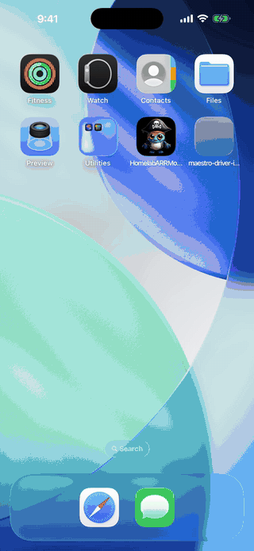
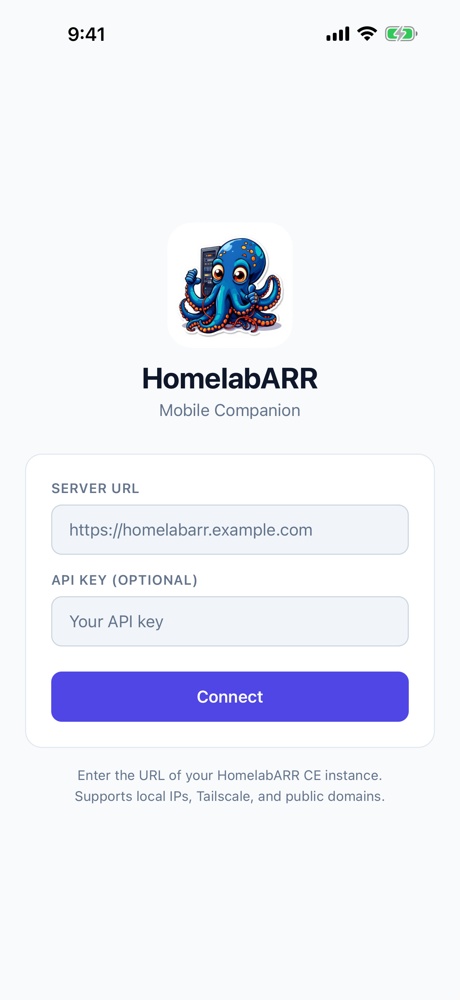
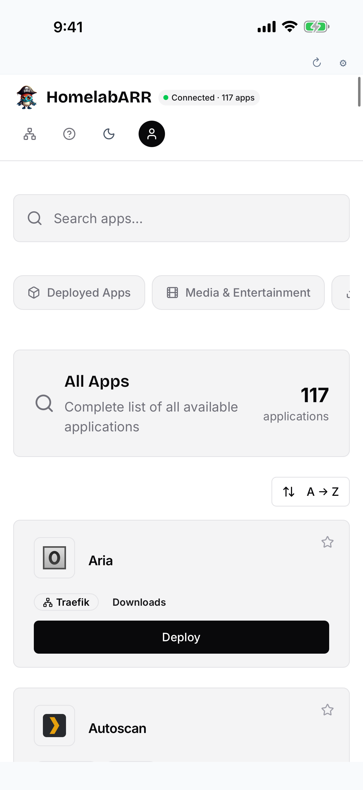
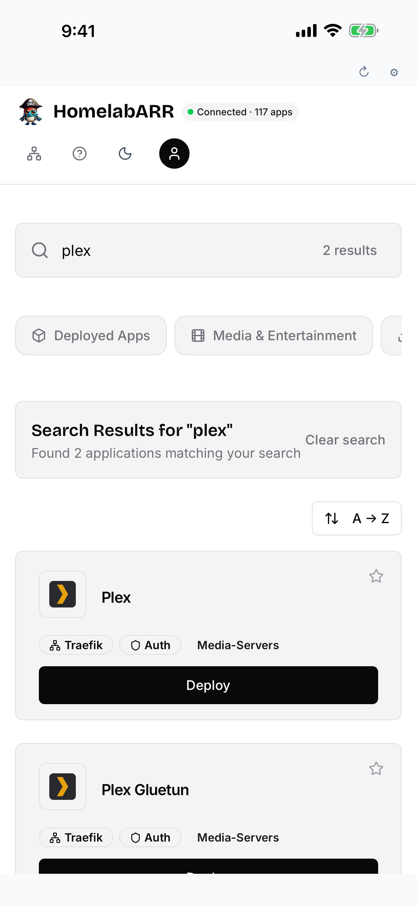
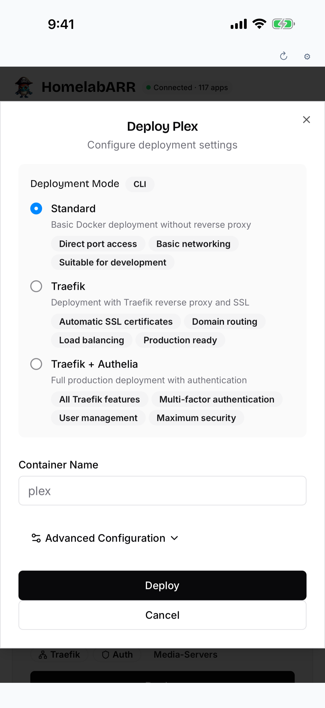
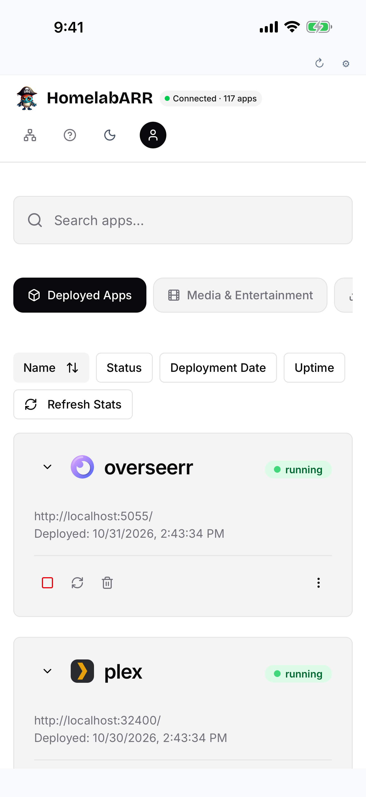
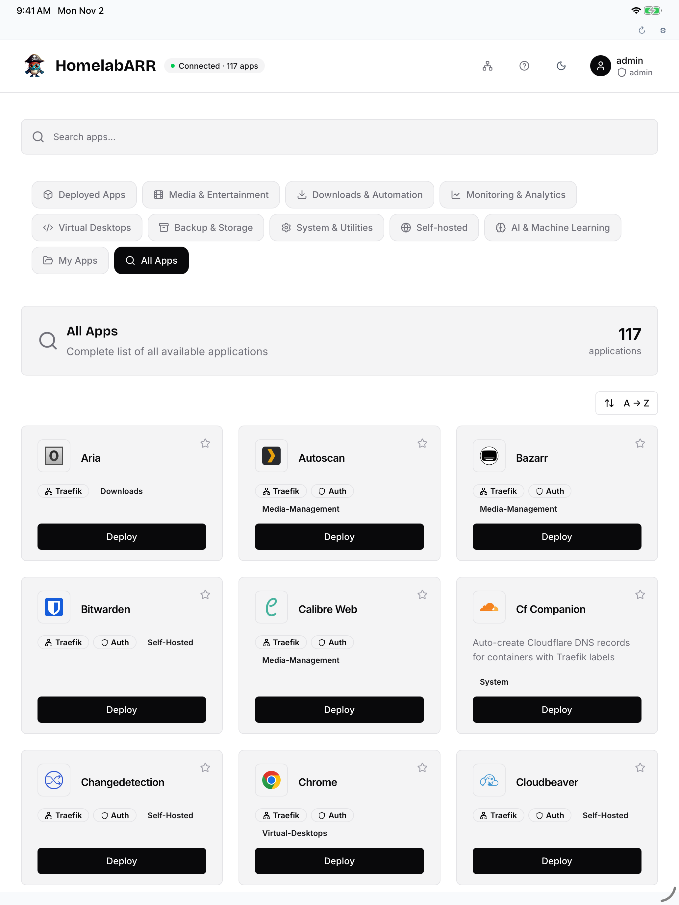

# HomelabARR Mobile Companion

> Manage your HomelabARR CE instance from your phone or tablet.

[](https://apps.apple.com/us/app/homelabarr-mobile/id6761244772)

Expo SDK 58 WebView wrapper around the existing HomelabARR CE dashboard (which is already mobile-responsive).

## See it work

[](docs/media/demo.mp4)

A minute in the app against the public demo, [demo.homelabarr.com](https://demo.homelabarr.com): connect, sign in, search, deploy, see what is running. [Watch the full-quality MP4](docs/media/demo.mp4).

| Connect | Catalog | Search | Deploy | Running apps |
|---|---|---|---|---|
|  |  |  |  |  |

On iPad the dashboard uses the full width:



## Current version

1.1.0. What changed is in `fastlane/metadata/en-US/release_notes.txt`.

## Download

- **iOS**: [App Store](https://apps.apple.com/us/app/homelabarr-mobile/id6761244772) (live)
- **Android**: not released yet

## Features

- **First-launch setup** — enter server URL + optional API key
- **Remembers your server** — across launches; the API key is kept in the iOS keychain
- **Stays on your server** — only pages on your server open in the app, everything else opens in Safari
- **Dark/light mode** — follows system theme, syncs with CE dashboard
- **Pull-to-refresh** — swipe down to reload
- **Back navigation** — swipe gesture + header back button
- **External links** — opens in system browser
- **Connection error handling** — retry/change server on failure
- **Haptic feedback** — on connect/disconnect actions
- **NSAllowsLocalNetworking** — works with local IPs (192.168.x.x, Tailscale, etc.)

## Setup

1. Download from the [App Store](https://apps.apple.com/us/app/homelabarr-mobile/id6761244772)
2. Enter your HomelabARR CE server URL (e.g. `http://192.168.0.10:8084`)
3. Optionally enter your API key for authenticated access
4. Tap Connect

## Supported Server Connections

- **Local IP**: `http://192.168.0.10:8084`
- **Tailscale**: `https://homelabarr.tailnet-name.ts.net`
- **Public domain**: `https://homelabarr.example.com`
- **Cloudflare Tunnel**: Any HTTPS URL

## Development

```bash
cd homelabarr-mobile
npm install
npx expo start
```

Scan the QR code with Expo Go on your phone.


## Build

A standard Expo project. Build it with EAS (`eas build --platform ios`) or generate the native project with `npx expo prebuild --platform ios` and archive it in Xcode.

`npm install` applies `patches/expo-modules-jsi+58.0.21.patch`, which fixes an iOS build error on Xcode 26.2 and newer ([expo/expo#52754](https://github.com/expo/expo/issues/52754)).

## Store screenshots

The screenshots in `fastlane/screenshots/en-US` are the real app connected to the public demo. The Maestro flows in `fastlane/maestro` take them on an iPhone and an iPad simulator:

```bash
maestro --device <simulator-id> test -e OUT=$PWD/out/iphone fastlane/maestro/iphone.yaml
maestro --device <simulator-id> test -e OUT=$PWD/out/ipad fastlane/maestro/ipad.yaml
```

## Architecture

Single-file app (`App.tsx`). No router needed — the WebView handles all navigation internally.

The CE dashboard is already fully responsive, so this is intentionally thin: URL setup, WebView, done.

## Related

| Repo | Description |
|------|-------------|
| [imogenlabs/homelabarr-ce](https://github.com/imogenlabs/homelabarr-ce) | HomelabARR CE, the self-hosted dashboard this app opens |
| [eight.ly](https://eight.ly) | Eight.ly OS, the full homelab operating system from the same team |

---

Built by [Imogen Labs](https://imogenlabs.ai)
